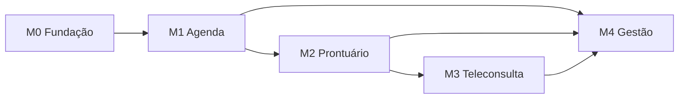

# Ordem de implementação e dependências

**Estado:** lote M0 da Fase 3 redigido; M1–M4 aguardam aprovação de cada lote. Esta ordem deriva do plano aprovado em `_work/02-plan.md`. Cada linha é uma sessão de implementação de uma spec; ler primeiro `00-constitution.md`, depois os documentos compartilhados citados pela spec. Contratos de M1–M4 devem ser completados em `shared/api-contracts.md` e `shared/data-model.md` antes de redigir e implementar o respectivo lote.

## Milestones e critérios de saída

| Milestone | Valor verificável | Situação documental |
| --- | --- | --- |
| M0 — Fundação | Ambiente, identidade, cadastro, consentimento, autorização, auditoria, arquivos e base operacional. | 25/25 specs redigidas; implementação pendente. |
| M1 — Agenda | Catálogo, grade, salas, reserva concorrente, consultas, lista de espera, lembretes, recepção e CSV. | Aguardando próximo lote. |
| M2 — Prontuário | Vínculo, histórico, evolução/adendo, alertas, documentos, acesso de urgência e projeção do paciente. | Aguardando lote. |
| M3 — Teleconsulta | Termo, vídeo P2P, arquivos e gravação revogável. | Aguardando lote; RNF-014 parcial. |
| M4 — Gestão | Indicadores, relatórios, auditoria consultável e ensaios de desempenho. | Aguardando lote. |

## Regra de execução

1. Implementar **somente uma spec por vez e nunca fora do escopo dela**.
2. Antes de cada spec, resolver as dependências executáveis e ler o contrato compartilhado correspondente. Uma spec documental redigida não comprova que sua dependência foi implementada.
3. Não iniciar uma spec bloqueada por decisão em `04-open-questions.md`. Os valores provisórios de `shared/parameters.md` permitem testes documentais, mas não substituem validação para produção.
4. Usar `yarn lint` para verificação estática; **nunca executar `tsc` para testes**. Executar os testes funcionais próprios de cada spec quando implementada.
5. Ao fim de cada milestone documental, atualizar `02-traceability-matrix.md` e parar para confirmação do usuário.

## Grafo entre milestones

## Sequência topológica completa

A tabela está em ordem topológica: todas as dependências de uma linha aparecem acima. `—` indica ausência de dependência executável, mas os documentos de referência continuam obrigatórios.

| Ordem | Milestone | Spec | Título | Software | Depende de | Documento |
| ---: | --- | --- | --- | --- | --- | --- |
| 1 | M0 | [BE-001](backend/BE-001-configuracao-ambientes.md) | Configuração, ambientes e composition root | back | — | Redigida |
| 2 | M0 | [BE-002](backend/BE-002-schema-identidade.md) | Schema Prisma inicial e migrations de identidade | back | BE-001 | Redigida |
| 3 | M0 | [BE-003](backend/BE-003-contrato-http-erros.md) | Contrato HTTP, validação e erros | back | BE-001 | Redigida |
| 4 | M0 | [BE-004](backend/BE-004-escrita-auditoria.md) | Escrita imutável da trilha de auditoria | back | BE-002, BE-003 | Redigida |
| 5 | M0 | [BE-005](backend/BE-005-rbac-dpo.md) | RBAC, privacy.dpo e autorização por recurso | back | BE-002, BE-004 | Redigida |
| 6 | M0 | [BE-006](backend/BE-006-dispatcher-notificacoes.md) | Dispatcher de notificações, EmailSender e portal | back | BE-003, BE-004 | Redigida |
| 7 | M0 | [BE-007](backend/BE-007-seed-convites-internos.md) | Seed do admin e convite de usuários internos | back | BE-005, BE-006 | Redigida |
| 8 | M0 | [BE-008](backend/BE-008-login-mfa-sessoes.md) | Login, MFA, sessões e bloqueio por tentativas | back | BE-005, BE-007 | Redigida |
| 9 | M0 | [BE-009](backend/BE-009-recuperacao-contatos.md) | Recuperação de senha e confirmação de contato | back | BE-006, BE-008 | Redigida |
| 10 | M0 | [BE-010](backend/BE-010-cadastro-paciente-responsavel.md) | Cadastro de paciente, responsável e dependentes | back | BE-002, BE-003, BE-006 | Redigida |
| 11 | M0 | [BE-013](backend/BE-013-arquivos-scanner.md) | FileStorage cifrado, links e MalwareScanner de desenvolvimento | back | BE-004, BE-005 | Redigida |
| 12 | M0 | [BE-011](backend/BE-011-consentimento-dados.md) | Versões, aceite presencial e revogação de consentimento | back | BE-004, BE-010, BE-013 | Redigida |
| 13 | M0 | [BE-012](backend/BE-012-solicitacoes-titular.md) | Solicitações do titular, exportação e fila do DPO | back | BE-005, BE-011 | Redigida |
| 14 | M0 | [BE-014](backend/BE-014-observabilidade.md) | Health, logs, métricas e alertas operacionais | back | BE-001, BE-004 | Redigida |
| 15 | M0 | [BE-015](backend/BE-015-backup-restauracao.md) | Backup, restauração e retenção operacional | back | BE-002, BE-014 | Redigida |
| 16 | M0 | [FE-001](frontend/FE-001-tokens-tema.md) | Tokens, fontes e alternância de tema | front | — | Redigida |
| 17 | M0 | [FE-002](frontend/FE-002-primitives-estados.md) | Primitives, estados e acessibilidade de base | front | FE-001 | Redigida |
| 18 | M0 | [FE-003](frontend/FE-003-shell-rotas.md) | Shell responsivo, navegação e rotas por perfil | front | FE-001, FE-002, BE-005 | Redigida |
| 19 | M0 | [FE-004](frontend/FE-004-cliente-http-sessao.md) | Cliente HTTP, sessão e proteção de rotas | front | FE-003, BE-003, BE-008 | Redigida |
| 20 | M0 | [FE-005](frontend/FE-005-login-mfa.md) | Tela de login e desafio MFA | front | FE-004, BE-008 | Redigida |
| 21 | M0 | [FE-006](frontend/FE-006-convite-recuperacao.md) | Telas de convite e recuperação de acesso | front | FE-004, BE-007, BE-009 | Redigida |
| 22 | M0 | [FE-007](frontend/FE-007-cadastro-dependentes-consentimento.md) | Autocadastro, dependentes e consentimento inicial | front | FE-002, FE-004, BE-010, BE-011 | Redigida |
| 23 | M0 | [FE-008](frontend/FE-008-perfil-privacidade.md) | Perfil, contatos, consentimentos e direitos do titular | front | FE-004, BE-009, BE-011, BE-012 | Redigida |
| 24 | M0 | [FE-009](frontend/FE-009-administracao-contas.md) | Administração de contas, perfis e convites | front | FE-003, FE-004, BE-005, BE-007 | Redigida |
| 25 | M0 | [FE-039](frontend/FE-039-cadastro-presencial-consentimento.md) | Cadastro presencial de paciente e consentimento assinado | front | FE-003, FE-004, BE-010, BE-011, BE-013 | Redigida |
| 26 | M1 | BE-016 (planejada) | Profissionais, especialidades e duração padrão | back | BE-005, BE-007 | Planejada |
| 27 | M1 | BE-017 (planejada) | Cadastro e inativação de salas | back | BE-005, BE-016 | Planejada |
| 28 | M1 | BE-018 (planejada) | Grade, férias e bloqueios do profissional | back | BE-016, BE-004 | Planejada |
| 29 | M1 | BE-019 (planejada) | Consulta de disponibilidade e antecedência | back | BE-017, BE-018 | Planejada |
| 30 | M1 | BE-020 (planejada) | Reserva atômica sem sobreposição | back | BE-017, BE-018, BE-019 | Planejada |
| 31 | M1 | BE-021 (planejada) | Confirmação de consulta e alocação de sala | back | BE-010, BE-011, BE-020, BE-006 | Planejada |
| 32 | M1 | BE-022 (planejada) | Reagendamento transacional | back | BE-020, BE-021 | Planejada |
| 33 | M1 | BE-023 (planejada) | Cancelamento e liberação de horário | back | BE-021, BE-006 | Planejada |
| 34 | M1 | BE-024 (planejada) | Espera, oferta e encaixe fora da grade | back | BE-020, BE-023, BE-006 | Planejada |
| 35 | M1 | BE-025 (planejada) | Lembretes, respostas, preferências e retry | back | BE-006, BE-021, BE-023 | Planejada |
| 36 | M1 | BE-026 (planejada) | Check-in e fila de atendimento | back | BE-021, BE-022 | Planejada |
| 37 | M1 | BE-027 (planejada) | No-show, justificativas e suspensão online | back | BE-025, BE-026 | Planejada |
| 38 | M1 | BE-028 (planejada) | Importação CSV demonstrativa de pacientes | back | BE-010, BE-011, BE-004 | Planejada |
| 39 | M1 | BE-029 (planejada) | Importação CSV demonstrativa de agenda | back | BE-016, BE-017, BE-020, BE-028 | Planejada |
| 40 | M1 | FE-010 (planejada) | Gestão de especialidades, profissionais e salas | front | FE-003, FE-004, BE-016, BE-017 | Planejada |
| 41 | M1 | FE-011 (planejada) | Grade e bloqueios do profissional | front | FE-010, BE-018 | Planejada |
| 42 | M1 | FE-012 (planejada) | Busca de especialidade e horários do paciente | front | FE-003, FE-004, BE-019 | Planejada |
| 43 | M1 | FE-013 (planejada) | Confirmação de agendamento do paciente | front | FE-007, FE-012, BE-021 | Planejada |
| 44 | M1 | FE-014 (planejada) | Minhas consultas, reagendar e cancelar | front | FE-013, BE-022, BE-023 | Planejada |
| 45 | M1 | FE-015 (planejada) | Agenda operacional da recepção | front | FE-003, BE-021, BE-026, BE-027 | Planejada |
| 46 | M1 | FE-016 (planejada) | Agendar e alterar consulta pela recepção | front | FE-015, BE-021, BE-022, BE-023 | Planejada |
| 47 | M1 | FE-017 (planejada) | Lista de espera e encaixe | front | FE-012, FE-015, BE-024 | Planejada |
| 48 | M1 | FE-018 (planejada) | Check-in, atrasos e no-show na agenda | front | FE-015, BE-026, BE-027 | Planejada |
| 49 | M1 | FE-019 (planejada) | Prévia e confirmação do CSV de pacientes | front | FE-009, BE-028 | Planejada |
| 50 | M1 | FE-020 (planejada) | Prévia e confirmação do CSV de agenda | front | FE-015, FE-019, BE-029 | Planejada |
| 51 | M2 | BE-030 (planejada) | Vínculo assistencial, janelas e reconciliação da agenda existente | back | BE-005, BE-021, BE-023, BE-027 | Planejada |
| 52 | M2 | BE-031 (planejada) | Acesso de urgência, expiração e revisão | back | BE-030, BE-004, BE-006 | Planejada |
| 53 | M2 | BE-032 (planejada) | Leitura do prontuário e timeline auditada | back | BE-030, BE-004, BE-013 | Planejada |
| 54 | M2 | BE-033 (planejada) | Lançamento manual de histórico importado | back | BE-032, BE-005 | Planejada |
| 55 | M2 | BE-034 (planejada) | Catálogos locais CID-10 e TUSS | back | BE-002, BE-003 | Planejada |
| 56 | M2 | BE-035 (planejada) | Rascunho e salvamento periódico da evolução | back | BE-032, BE-034 | Planejada |
| 57 | M2 | BE-036 (planejada) | Finalização imutável e adendos justificados | back | BE-035, BE-004 | Planejada |
| 58 | M2 | BE-037 (planejada) | Alergias, condições críticas e alertas | back | BE-032, BE-004 | Planejada |
| 59 | M2 | BE-038 (planejada) | Catálogo documental e SignatureProvider | back | BE-013, BE-034, BE-004 | Planejada |
| 60 | M2 | BE-039 (planejada) | Prescrição e verificação de alergia | back | BE-037, BE-038, BE-036 | Planejada |
| 61 | M2 | BE-040 (planejada) | Pedidos de exames assinados | back | BE-038, BE-034, BE-036 | Planejada |
| 62 | M2 | BE-041 (planejada) | Anexo de resultados e aviso ao profissional | back | BE-040, BE-013, BE-006 | Planejada |
| 63 | M2 | BE-042 (planejada) | Atestados e demais documentos clínicos | back | BE-038, BE-036 | Planejada |
| 64 | M2 | BE-043 (planejada) | Projeção autorizada do histórico do paciente | back | BE-032, BE-039, BE-041, BE-042, BE-012 | Planejada |
| 65 | M2 | FE-021 (planejada) | Agenda clínica, cabeçalho e timeline do prontuário | front | FE-003, BE-030, BE-032, BE-037 | Planejada |
| 66 | M2 | FE-022 (planejada) | Editor de evolução, rascunho e adendo | front | FE-021, BE-034, BE-035, BE-036 | Planejada |
| 67 | M2 | FE-023 (planejada) | Alertas clínicos e condições críticas | front | FE-021, BE-037 | Planejada |
| 68 | M2 | FE-024 (planejada) | Prescrição e assinatura de desenvolvimento | front | FE-021, FE-023, BE-039 | Planejada |
| 69 | M2 | FE-025 (planejada) | Solicitação de exames e resultados | front | FE-021, BE-040, BE-041 | Planejada |
| 70 | M2 | FE-026 (planejada) | Emissão e consulta de documentos clínicos | front | FE-021, BE-042 | Planejada |
| 71 | M2 | FE-027 (planejada) | Histórico e documentos do paciente | front | FE-008, BE-043 | Planejada |
| 72 | M2 | FE-028 (planejada) | Solicitação de acesso de urgência | front | FE-021, BE-031 | Planejada |
| 73 | M2 | FE-029 (planejada) | Entrada e conferência de histórico importado | front | FE-021, BE-033 | Planejada |
| 74 | M3 | BE-044 (planejada) | Consentimento específico de teleconsulta | back | BE-011, BE-021, BE-004 | Planejada |
| 75 | M3 | BE-045 (planejada) | Sessão, autorização e sinalização WebSocket | back | BE-044, BE-030, BE-006 | Planejada |
| 76 | M3 | BE-046 (planejada) | Compartilhamento de arquivos na sessão | back | BE-045, BE-013, BE-041 | Planejada |
| 77 | M3 | BE-047 (planejada) | Consentimento, guarda e expurgo de gravação | back | BE-045, BE-013, BE-004 | Planejada |
| 78 | M3 | FE-030 (planejada) | Termo, preparo e teste de dispositivos | front | FE-014, BE-044, BE-045 | Planejada |
| 79 | M3 | FE-031 (planejada) | Sala de espera e vídeo do paciente | front | FE-030, BE-045 | Planejada |
| 80 | M3 | FE-032 (planejada) | Sala de vídeo e prontuário do profissional | front | FE-021, FE-030, BE-045 | Planejada |
| 81 | M3 | FE-033 (planejada) | Compartilhamento de arquivos em teleconsulta | front | FE-031, FE-032, BE-046 | Planejada |
| 82 | M3 | FE-034 (planejada) | Controles e aviso de gravação/revogação | front | FE-031, FE-032, BE-047 | Planejada |
| 83 | M4 | BE-048 (planejada) | Indicadores agregados e proteção contra reidentificação | back | BE-021, BE-027, BE-030 | Planejada |
| 84 | M4 | BE-049 (planejada) | Relatórios e exportação síncrona/assíncrona | back | BE-048, BE-006, BE-004 | Planejada |
| 85 | M4 | BE-050 (planejada) | Consulta/exportação auditada da trilha | back | BE-004, BE-005, BE-031 | Planejada |
| 86 | M4 | BE-051 (planejada) | Massa reprodutível e ensaios de carga/concorrência da API | back | BE-020, BE-032, BE-048, BE-049 | Planejada |
| 87 | M4 | BE-052 (planejada) | Ensaios de qualidade/capacidade da teleconsulta | back | BE-045, BE-047 | Planejada |
| 88 | M4 | FE-035 (planejada) | Painel gerencial de indicadores | front | FE-003, BE-048 | Planejada |
| 89 | M4 | FE-036 (planejada) | Relatórios e exportação | front | FE-035, BE-049 | Planejada |
| 90 | M4 | FE-037 (planejada) | Pesquisa e exportação de auditoria | front | FE-003, BE-050 | Planejada |
| 91 | M4 | FE-038 (planejada) | Fila do DPO e revisão de consentimentos | front | FE-008, FE-037, BE-012, BE-050 | Planejada |

## Pontos de atenção na ordem

- **M0:** BE-008/009 e FE-005 usam decisões pendentes sobre método de MFA, bloqueio por tentativas e histórico de senhas (P-05). FE-004 precisa de política final de cookie, CSRF e confirmação de telefone (P-12). A documentação existe; a implementação dessas partes depende das decisões.
- **M1:** BE-020 é a barreira transacional de sobreposição para profissional e sala. Confirmação, reagendamento, encaixe e importação da agenda passam por ela.
- **M2:** BE-030 reconcilia consultas já confirmadas no M1 ao criar o vínculo clínico. BE-033/FE-029 aguardam decisão P-11 sobre quem pode lançar conteúdo clínico histórico.
- **M3:** o adaptador de assinatura dev e a solução de mídia P2P não demonstram validade jurídica nem E2E pleno. Ver limites em `04-open-questions.md`.
- **M4:** RNF-006/007/024 exigem ensaio e infraestrutura de homologação/produção; relatório documental, por si, não prova metas operacionais.

## Verificação das dependências

O plano contém **91 IDs únicos** (52 BE, 39 FE). Cada dependência declarada aparece antes da spec dependente na sequência acima. Portanto, o grafo planejado é acíclico. A verificação deve ser refeita se IDs ou dependências mudarem nos lotes seguintes. O estado de cobertura por requisito está em `02-traceability-matrix.md`.
