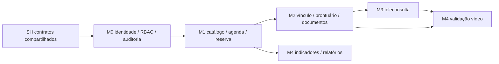

# Fase 2 — Plano de organização das specs

**Estado:** Fase 3 concluída documentalmente; lotes M0–M4 redigidos após autorização expressa do usuário em 23/10/2026. Base: inventário da Fase 1, DRS, arquitetura, documentos de front e decisões Q-01 a Q-23 em `specs/04-open-questions.md`.

## 1. Critérios de organização

1. Preservar **quatro marcos de valor** do DRS: M1 Agenda, M2 Prontuário, M3 Teleconsulta, M4 Gestão. Acrescentar M0 Fundação como pré-requisito técnico, sem tratá-lo como quinto sprint de produto.
2. Dividir cada requisito em entregas pequenas: uma capacidade de backend ou uma tela/fluxo de frontend por spec. Se a redação da Fase 3 ultrapassar uma sessão implementável, subdividir mantendo o ID de requisito e atualizar a matriz.
3. Colocar contrato REST/WebSocket, erros, modelo de dados, regras, parâmetros, visibilidade e importação **uma vez** em documentos compartilhados. Specs BE/FE referenciam esses documentos e declaram os IDs de specs de que dependem.
4. Todo dado clínico e pessoal passa por autorização no servidor e auditoria. Adaptadores locais de assinatura, e-mail, arquivos, malware e gravação devem ser identificados como desenvolvimento; os bloqueios de produção ficam documentados.
5. Tratar as diferenças frente ao DRS como decisões explícitas, não como correções silenciosas: RN-008 (adendo sempre), RN-009/RNF-017 (assinatura real pendente), RNF-013 (30 min interno), RNF-014 (mídia parcialmente atendida), RNF-022 (somente compatibilidade estrutural), RNF-009/010 (cenário p95), RN-005 (segundo lembrete).
6. Specs de tela usam layout explícito do Design System para Agenda/Prontuário. Outras telas são propostas de layout rastreadas ao DRS e às regras visuais, conforme Q-14.
7. Nenhuma spec pede `tsc` como teste. A Definition of Done usa apenas o lint disponível no workspace para verificação estática; testes funcionais pertinentes são definidos na própria spec sem invocar `tsc`.

## 2. Estrutura proposta de arquivos para a Fase 3

```text
specs/
├── 00-constitution.md
├── 01-overview.md
├── 02-traceability-matrix.md
├── 03-implementation-order.md
├── 04-open-questions.md
├── _work/
│   ├── 01-inventory.md
│   └── 02-plan.md
├── shared/
│   ├── data-model.md
│   ├── api-contracts.md
│   ├── business-rules.md
│   ├── access-policy.md
│   ├── parameters.md
│   ├── import-templates.md
│   └── performance-scenario.md
├── backend/
│   ├── architecture.md
│   └── BE-NNN-slug.md
└── frontend/
    ├── design-system.md
    ├── screens-map.md
    └── FE-NNN-slug.md
AGENTS.md  (raiz; criado somente na Fase 3)
```

### Artefatos compartilhados, antes das specs executáveis

Estes são documentos de referência (`software: shared`), não sessões de implementação BE/FE; o template de oito seções do pedido aplica-se aos arquivos BE/FE. Todos os contratos necessários a back/front serão definidos aqui antes dos lotes correspondentes. Quando o contrato de um módulo for detalhado em lote posterior, sua seção será adicionada ao mesmo arquivo, sem duplicação.

| ID | Arquivo / software | Conteúdo e origem | Pré-requisito |
| --- | --- | --- | --- |
| SH-001 | `00-constitution.md` / shared | Stack real, convenções, limites de escopo, segurança, Definition of Done e precedência das fontes. | Inventário + decisões |
| SH-002 | `01-overview.md` / shared | Visão, perfis, glossário, escopo e exclusões. | SH-001 |
| SH-003 | `shared/business-rules.md` / shared | RN-001–012, decisões Q-03–12/18/21 e divergências documentadas. | SH-002 |
| SH-004 | `shared/parameters.md` / shared | Defaults/configurações de identidade, agenda, acesso, gravação, arquivos, migração e performance com dono/status. | SH-003 |
| SH-005 | `shared/access-policy.md` / shared | Matriz de permissões dos cinco perfis, privacy.dpo, vínculo clínico, urgência, responsável legal e projeção do portal. | SH-003–004 |
| SH-006 | `shared/data-model.md` / shared | Entidades e integridade, schema Prisma novo, identificadores, retenção e correspondência estrutural FHIR/TISS. | SH-003–005 |
| SH-007 | `shared/api-contracts.md` / shared | REST/JSON, WebSocket, payloads, estados, erros, auth, paginação, uploads, contratos de eventos/notificação e versionamento. | SH-004–006 |
| SH-008 | `shared/import-templates.md` / shared | CSV paciente/agenda, validação, idempotência, origem, preview e exemplos fictícios. | SH-006–007 |
| SH-009 | `shared/performance-scenario.md` / shared | Massa, perfis de carga, ambiente, métricas, concorrência e limites provisórios de Q-22. | SH-004, SH-007 |
| SH-010 | `backend/architecture.md` / shared para implementação back | Clean Architecture adotada, árvore real, portas/adaptadores, transações, operações e A-01–A-10. | SH-003–009 |
| SH-011 | `frontend/design-system.md` / shared para implementação front | Tokens, componentes, estados, temas e responsividade extraídos dos dois docs de front. | SH-001–002 |
| SH-012 | `frontend/screens-map.md` / shared para implementação front | Duas telas documentadas e propostas para demais fluxos, rotas, atores, API e cobertura FE. | SH-005, SH-007, SH-011 |

`02-traceability-matrix.md` e `03-implementation-order.md` são índices vivos; a cada lote da Fase 3 serão atualizados. `04-open-questions.md` mantém status e portões de produção. O `AGENTS.md` da raiz será criado na Fase 3 com stack, comandos realmente existentes, convenções, ordem de leitura começando em `specs/00-constitution.md`, regra **“implemente somente uma spec por vez e nunca fora do escopo dela”** e proibição de executar `tsc` para testes.

## 3. Lista completa das specs executáveis

Convenção: `—` = sem dependência de outra spec executável; documentos SH são pré-condição global e constarão em “Contexto necessário”. A sequência abaixo é **topológica**: qualquer ID em “Depende de” aparece antes. `RF`, `RN` e `RNF` apontam ao DRS; `UI` aponta aos documentos de front. Requisitos de segurança, acessibilidade e desempenho terão critérios transversais adicionais nas specs afetadas, mesmo quando listados numa spec principal.

### M0 — Fundação técnica e primeiro acesso

**Resultado demonstrável:** aplicação inicia, primeiro administrador e usuários internos recebem convite, paciente/responsável cria cadastro e consentimento, login/recuperação funciona; autorização e auditoria são base obrigatória. Backup/monitoramento têm procedimentos documentados e pontos de execução verificáveis.

| ID | Título | Software | Depende de | Requisitos cobertos |
| --- | --- | --- | --- | --- |
| BE-001 | Configuração, ambientes e composition root | back | — | RNF-024 |
| BE-002 | Schema Prisma inicial e migrations de identidade | back | BE-001 | RF-001, RF-029, RNF-012 |
| BE-003 | Contrato HTTP, validação e erros | back | BE-001 | RNF-021 |
| BE-004 | Escrita imutável da trilha de auditoria | back | BE-002, BE-003 | RF-032, RNF-015 |
| BE-005 | RBAC, privacy.dpo e autorização por recurso | back | BE-002, BE-004 | RF-029, RNF-012, RN-007 |
| BE-006 | Dispatcher de notificações, EmailSender e portal | back | BE-003, BE-004 | RF-013, RN-005 |
| BE-007 | Seed do admin e convite de usuários internos | back | BE-005, BE-006 | RF-029, RNF-013 |
| BE-008 | Login, MFA, sessões e bloqueio por tentativas | back | BE-005, BE-007 | RF-002, RNF-013 |
| BE-009 | Recuperação de senha e confirmação de contato | back | BE-006, BE-008 | RF-003, RF-005, RNF-013 |
| BE-010 | Cadastro de paciente, responsável e dependentes | back | BE-002, BE-003, BE-006 | RF-001, RNF-016 |
| BE-013 | FileStorage cifrado, links e MalwareScanner de desenvolvimento | back | BE-004, BE-005 | RF-020, RF-026, RF-027, RNF-014 |
| BE-011 | Versões, aceite presencial e revogação de consentimento | back | BE-004, BE-010, BE-013 | RF-004, RNF-016 |
| BE-012 | Solicitações do titular, exportação e fila do DPO | back | BE-005, BE-011 | RF-005, RNF-016 |
| BE-014 | Health, logs, métricas e alertas operacionais | back | BE-001, BE-004 | RNF-006, RNF-024 |
| BE-015 | Backup, restauração e retenção operacional | back | BE-002, BE-014 | RNF-007, RNF-006, RN-012 |
| FE-001 | Tokens, fontes e alternância de tema | front | — | UI-001, UI-003, UI-004, UI-005, UI-014, UI-016, RNF-020 |
| FE-002 | Primitives, estados e acessibilidade de base | front | FE-001 | UI-002, UI-006, UI-007, UI-012, UI-013, UI-015, RNF-003, RNF-021 |
| FE-003 | Shell responsivo, navegação e rotas por perfil | front | FE-001, FE-002, BE-005 | UI-001, UI-008, UI-011, UI-015, RNF-018, RNF-019, RNF-020 |
| FE-004 | Cliente HTTP, sessão e proteção de rotas | front | FE-003, BE-003, BE-008 | RF-002, RNF-012, RNF-013 |
| FE-005 | Tela de login e desafio MFA | front | FE-004, BE-008 | RF-002, RNF-013 |
| FE-006 | Telas de convite e recuperação de acesso | front | FE-004, BE-007, BE-009 | RF-003, RF-029 |
| FE-007 | Autocadastro, dependentes e consentimento inicial | front | FE-002, FE-004, BE-010, BE-011 | RF-001, RF-004, RNF-003, RNF-019 |
| FE-008 | Perfil, contatos, consentimentos e direitos do titular | front | FE-004, BE-009, BE-011, BE-012 | RF-004, RF-005, RNF-016 |
| FE-009 | Administração de contas, perfis e convites | front | FE-003, FE-004, BE-005, BE-007 | RF-029, RNF-012 |
| FE-039 | Cadastro presencial de paciente e consentimento assinado | front | FE-003, FE-004, BE-010, BE-011, BE-013 | RF-001, RF-004 |

### M1 — Agenda confiável

**Resultado demonstrável:** catálogo/grade/salas publicados, paciente agenda e gerencia consulta, recepção opera o dia, lista de espera e lembretes funcionam; teste concorrente mostra uma única reserva. Importação CSV demonstrativa inicia convivência controlada com dados legados.

| ID | Título | Software | Depende de | Requisitos cobertos |
| --- | --- | --- | --- | --- |
| BE-016 | Profissionais, especialidades e duração padrão | back | BE-005, BE-007 | RF-028, RN-002 |
| BE-017 | Cadastro e inativação de salas | back | BE-005, BE-016 | RF-007, RF-008, RN-001 |
| BE-018 | Grade, férias e bloqueios do profissional | back | BE-016, BE-004 | RF-011, RN-002 |
| BE-019 | Consulta de disponibilidade e antecedência | back | BE-017, BE-018 | RF-006, RN-003, RNF-009 |
| BE-020 | Reserva atômica sem sobreposição | back | BE-017, BE-018, BE-019 | RF-008, RN-001, RNF-010 |
| BE-021 | Confirmação de consulta e alocação de sala | back | BE-010, BE-011, BE-020, BE-006 | RF-007, RN-001, RN-002, RN-003, RN-006 |
| BE-022 | Reagendamento transacional | back | BE-020, BE-021 | RF-009, RN-004 |
| BE-023 | Cancelamento e liberação de horário | back | BE-021, BE-006 | RF-010, RN-004 |
| BE-024 | Espera, oferta e encaixe fora da grade | back | BE-020, BE-023, BE-006 | RF-012, RN-001, RN-003 |
| BE-025 | Lembretes, respostas, preferências e retry | back | BE-006, BE-021, BE-023 | RF-013, RN-005 |
| BE-026 | Check-in e fila de atendimento | back | BE-021, BE-022 | RF-014 |
| BE-027 | No-show, justificativas e suspensão online | back | BE-025, BE-026 | RF-015, RN-005, RN-006 |
| BE-028 | Importação CSV demonstrativa de pacientes | back | BE-010, BE-011, BE-004 | RF-001, RF-016, RNF-016 |
| BE-029 | Importação CSV demonstrativa de agenda | back | BE-016, BE-017, BE-020, BE-028 | RF-007, RF-008, RN-001 |
| FE-010 | Gestão de especialidades, profissionais e salas | front | FE-003, FE-004, BE-016, BE-017 | RF-028, RF-007 |
| FE-011 | Grade e bloqueios do profissional | front | FE-010, BE-018 | RF-011 |
| FE-012 | Busca de especialidade e horários do paciente | front | FE-003, FE-004, BE-019 | RF-006, RNF-001, RNF-019 |
| FE-013 | Confirmação de agendamento do paciente | front | FE-007, FE-012, BE-021 | RF-007, RF-008, RNF-001, RNF-021, RNF-004 |
| FE-014 | Minhas consultas, reagendar e cancelar | front | FE-013, BE-022, BE-023 | RF-009, RF-010, RN-004 |
| FE-015 | Agenda operacional da recepção | front | FE-003, BE-021, BE-026, BE-027 | RF-006, RF-014, RF-015, RNF-002, RNF-004, UI-009, UI-011 |
| FE-016 | Agendar e alterar consulta pela recepção | front | FE-015, BE-021, BE-022, BE-023 | RF-007, RF-009, RF-010, RNF-002 |
| FE-017 | Lista de espera e encaixe | front | FE-012, FE-015, BE-024 | RF-012, RN-001 |
| FE-018 | Check-in, atrasos e no-show na agenda | front | FE-015, BE-026, BE-027 | RF-014, RF-015, RNF-002 |
| FE-019 | Prévia e confirmação do CSV de pacientes | front | FE-009, BE-028 | RF-001, RNF-021 |
| FE-020 | Prévia e confirmação do CSV de agenda | front | FE-015, FE-019, BE-029 | RF-007, RF-008, RNF-021 |

### M2 — Prontuário e documentos clínicos

**Resultado demonstrável:** profissional vinculado lê histórico, registra evolução/adendo e alertas, emite documentos em fluxo de assinatura de desenvolvimento claramente sem validade jurídica; paciente vê somente a projeção publicada. Acesso de urgência é temporário e auditado.

| ID | Título | Software | Depende de | Requisitos cobertos |
| --- | --- | --- | --- | --- |
| BE-030 | Vínculo assistencial, janelas e reconciliação da agenda existente | back | BE-005, BE-021, BE-023, BE-027 | RN-007, RF-016, RNF-012 |
| BE-031 | Acesso de urgência, expiração e revisão | back | BE-030, BE-004, BE-006 | RF-023, RN-007, RNF-015 |
| BE-032 | Leitura do prontuário e timeline auditada | back | BE-030, BE-004, BE-013 | RF-016, RF-022, RN-007, RNF-009 |
| BE-033 | Lançamento manual de histórico importado | back | BE-032, BE-005 | RF-016, RF-022, RN-012, RNF-005 |
| BE-034 | Catálogos locais CID-10 e TUSS | back | BE-002, BE-003 | RF-017, RF-020, RNF-022 |
| BE-035 | Rascunho e salvamento periódico da evolução | back | BE-032, BE-034 | RF-017, RNF-008 |
| BE-036 | Finalização imutável e adendos justificados | back | BE-035, BE-004 | RF-017, RN-008, RN-012, RNF-005 |
| BE-037 | Alergias, condições críticas e alertas | back | BE-032, BE-004 | RF-018, RN-007 |
| BE-038 | Catálogo documental e SignatureProvider | back | BE-013, BE-034, BE-004 | RN-009, RNF-017 |
| BE-039 | Prescrição e verificação de alergia | back | BE-037, BE-038, BE-036 | RF-019, RN-009 |
| BE-040 | Pedidos de exames assinados | back | BE-038, BE-034, BE-036 | RF-020, RN-009 |
| BE-041 | Anexo de resultados e aviso ao profissional | back | BE-040, BE-013, BE-006 | RF-020, RN-012 |
| BE-042 | Atestados e demais documentos clínicos | back | BE-038, BE-036 | RF-021, RN-009, RN-012 |
| BE-043 | Projeção autorizada do histórico do paciente | back | BE-032, BE-039, BE-041, BE-042, BE-012 | RF-022, RN-007, RNF-016 |
| FE-021 | Agenda clínica, cabeçalho e timeline do prontuário | front | FE-003, BE-030, BE-032, BE-037 | RF-016, RF-022, UI-010, UI-012, RNF-004 |
| FE-022 | Editor de evolução, rascunho e adendo | front | FE-021, BE-034, BE-035, BE-036 | RF-017, RN-008, RNF-008, UI-010 |
| FE-023 | Alertas clínicos e condições críticas | front | FE-021, BE-037 | RF-018, UI-010, UI-012 |
| FE-024 | Prescrição e assinatura de desenvolvimento | front | FE-021, FE-023, BE-039 | RF-019, RN-009 |
| FE-025 | Solicitação de exames e resultados | front | FE-021, BE-040, BE-041 | RF-020, RNF-021 |
| FE-026 | Emissão e consulta de documentos clínicos | front | FE-021, BE-042 | RF-021, RN-009 |
| FE-027 | Histórico e documentos do paciente | front | FE-008, BE-043 | RF-022, RNF-003, RNF-019 |
| FE-028 | Solicitação de acesso de urgência | front | FE-021, BE-031 | RF-023, RNF-015 |
| FE-029 | Entrada e conferência de histórico importado | front | FE-021, BE-033 | RF-016, RF-022, RNF-005 |
| FE-040 | Envio de resultados pelo paciente e recepção | front | FE-003, FE-004, FE-027, BE-041 | RF-020, RNF-021 |
| FE-041 | Configuração de tipos documentais | front | FE-003, FE-004, BE-038 | RN-009, RNF-017 |

### M3 — Teleconsulta integrada

**Resultado demonstrável:** paciente aceita termo, testa dispositivos, entra em sala P2P e profissional atende com prontuário; arquivos podem ser compartilhados e gravação opcional pode ser iniciada/revogada. Mídia fim a fim e produção clínica continuam marcadas com cobertura parcial até solução aprovada.

| ID | Título | Software | Depende de | Requisitos cobertos |
| --- | --- | --- | --- | --- |
| BE-044 | Consentimento específico de teleconsulta | back | BE-011, BE-021, BE-004 | RF-024, RN-010 |
| BE-045 | Sessão, autorização e sinalização WebSocket | back | BE-044, BE-030, BE-006 | RF-025, RN-010, RNF-011, RNF-014 |
| BE-046 | Compartilhamento de arquivos na sessão | back | BE-045, BE-013, BE-041 | RF-026, RN-012 |
| BE-047 | Consentimento específico de gravação | back | BE-045, BE-004 | RF-027, RN-011 |
| BE-053 | Recebimento e guarda de gravação auxiliar | back | BE-047, BE-013 | RF-027, RN-011, RNF-014 |
| BE-054 | Revogação e expurgo de gravação | back | BE-053, BE-004 | RF-027, RN-011, RNF-014 |
| FE-030 | Termo, preparo e teste de dispositivos | front | FE-014, BE-044, BE-045 | RF-024, RF-025, RNF-025 |
| FE-031 | Sala de espera e vídeo do paciente | front | FE-030, BE-045 | RF-025, RNF-008, RNF-018, RNF-019, RNF-023 |
| FE-032 | Sala de vídeo e prontuário do profissional | front | FE-021, FE-030, BE-045 | RF-025, RN-007, RNF-011, RNF-023 |
| FE-033 | Compartilhamento de arquivos em teleconsulta | front | FE-031, FE-032, BE-046 | RF-026, RNF-014 |
| FE-034 | Controles e aviso de gravação/revogação | front | FE-031, FE-032, BE-054 | RF-027, RN-011 |

### M4 — Gestão, governança e medição final

**Resultado demonstrável:** indicadores e relatórios agregados, auditoria consultável pelo admin/DPO autorizado, fila de titulares, evidências de desempenho/carga/recuperação e matriz de cobertura final. Recursos de gestão necessários antes do M4 já foram antecipados em M0/M1.

| ID | Título | Software | Depende de | Requisitos cobertos |
| --- | --- | --- | --- | --- |
| BE-048 | Indicadores agregados e proteção contra reidentificação | back | BE-021, BE-027, BE-030 | RF-030, RNF-016 |
| BE-049 | Relatórios e exportação síncrona/assíncrona | back | BE-048, BE-006, BE-004 | RF-031, RNF-015 |
| BE-050 | Consulta/exportação auditada da trilha | back | BE-004, BE-005, BE-031 | RF-032, RNF-015 |
| BE-051 | Massa reprodutível e ensaios de carga/concorrência da API | back | BE-020, BE-032, BE-048, BE-049 | RNF-009, RNF-010, RF-008 |
| BE-052 | Ensaios de qualidade/capacidade da teleconsulta | back | BE-045, BE-054 | RNF-010, RNF-011, RNF-014 |
| FE-035 | Painel gerencial de indicadores | front | FE-003, BE-048 | RF-030, RNF-016, UI-002 |
| FE-036 | Relatórios e exportação | front | FE-035, BE-049 | RF-031, RNF-021 |
| FE-037 | Pesquisa e exportação de auditoria | front | FE-003, BE-050 | RF-032, RNF-015 |
| FE-038 | Fila do DPO e revisão de consentimentos | front | FE-008, FE-037, BE-012, BE-050 | RF-004, RF-005, RF-032, RNF-016 |

**Total final após M4:** 12 documentos SH de referência, **54 specs BE** e **41 specs FE** (95 specs executáveis). FE-039 separa o cadastro presencial; FE-040 separa upload de resultado por paciente/recepção; FE-041 separa a configuração do nível de assinatura; BE-047/053/054 separam consentimento, armazenamento e expurgo da gravação. Índices, matriz, perguntas e `AGENTS.md` são documentos de governança adicionais.

**Conferência do plano:** os 32 RF, 25 RNF, 12 RN e 16 UI do inventário aparecem em pelo menos uma linha BE/FE (85/85). Os 95 IDs são únicos e todas as dependências declaradas apontam para linhas anteriores. A Agenda tem FE-015 e o Prontuário tem FE-021/022; BE-043/FE-027 detalham a projeção do portal, conforme Q-03.

## 4. Marcos, critérios de saída e lotes da Fase 3

| Marco/lote | Contratos a completar antes do lote | Demonstração e evidências de saída |
| --- | --- | --- |
| M0 Fundação | SH-001–007, SH-010–012; bases de SH-008–009 | Cadastro digital e presencial de paciente/responsável, consentimento com termo assinado, admin seed, convite, login/MFA, recuperação, RBAC, auditoria, observabilidade e recuperação documentada. Lint das áreas alteradas e testes pertinentes no trabalho futuro. |
| M1 Agenda | Seções agenda de SH-003–008, parâmetros Q-16/Q-19 | Agenda publicada, reserva concorrente sem colisão, paciente/recepção operam, lembretes/check-in/no-show/espera e CSV demonstrativo. Teste simultâneo do mesmo intervalo. |
| M2 Prontuário | Seções clínicas de SH-003–007 e decisão Q-03/Q-21 | Vínculo e urgência auditados, evolução imutável/adendo, alertas, CID/TUSS, documentos com selo dev, projeção paciente e histórico importado identificado. |
| M3 Teleconsulta | Contrato WebSocket, mídia, arquivos e gravação em SH-004/007 | Termo, teste, sala P2P, reconexão, compartilhamento e revogação de gravação. Cobertura parcial RNF-014 e bloqueios de produção explícitos. |
| M4 Gestão | SH-009 e parâmetros de medição | Painel, relatórios, auditoria/DPO, carga/concorrência/vídeo; revisão de matriz e pendências. |

Ao fim de **cada lote**, atualizar `02-traceability-matrix.md` com requisito → spec, estado de cobertura (total/parcial/pendente) e decisão de desvio; atualizar `03-implementation-order.md`, conferir todas as telas e ausência de ciclos. Os lotes restantes foram autorizados expressamente pelo usuário em 23/10/2026. Na Fase 3, o primeiro lote inclui a constituição, visão, contratos de fundação, arquitetura, design system, mapa de telas, matriz inicial, ordem e `AGENTS.md` da raiz.

## 5. Dependências críticas e ausência de ciclos



- A-01–A-03: `backend/architecture.md` desenhará dependência de infraestrutura → aplicação/domínio e mapeará os caminhos reais. Sem referências de domínio para Express/Prisma/WebSocket.
- A-04: SH-005–007 serão a fonte única de políticas, modelos e contratos; FE consome BE concluída, e não um contrato implícito.
- A-05: BE-020 antecede agendamento, reagendamento, espera e importação de agenda; exclusão deve ser garantida transacionalmente no PostgreSQL para profissional e sala, inclusive encaixe.
- A-06–A-08: portas/adaptadores e bloqueios de produção são estabelecidos antes de prescrição/vídeo/arquivos; schema Prisma é novo e versionado por migrations.
- BE-013 exige AES-256 em repouso para dados sensíveis/anexos conforme RNF-014, inclusive no adaptador local. BE-030 reconcilia agendamentos confirmados antes do M2 e passa a criar/encerrar vínculo a cada confirmação/cancelamento.
- A-09: tabela está em ordem topológica; RBAC/auditoria e catálogo antecedem as funções que os usam. Nenhuma dependência aponta para uma spec posterior; não há ciclo planejado.
- A-10: BE-014/015 criam base operacional; BE-051/052 verificam carga, latência e mídia com cenário versionado. RNF-006/007 dependem de ambiente real para evidência de produção.

## 6. Portões e limitações que a matriz mostrará

1. **Cobertura parcial, não conformidade plena:** RNF-014 na mídia P2P/DTLS-SRTP; RN-009/RNF-017 em assinatura simulada. RF-019/020/021 terão fluxo demonstrável de desenvolvimento, mas emissão juridicamente válida em produção depende de provedor ICP-Brasil e validação jurídica. O plano não rotulará esses requisitos como integralmente atendidos.
2. **Produção bloqueada por adaptadores dev:** DevSignatureProvider e DevMalwareScanner são vedados em produção; provedores reais, armazenamento/criptografia, expurgo, DPO/jurídico e ensaios operacionais estão listados em `04-open-questions.md`.
3. **Parâmetros sem decisão:** Q-16/17 entram em SH-004 com defaults provisórios; Q-21 tem chaves de janela sem default ainda, e MFA/bloqueio também estão abertos. STUN/TURN e pré-teste de banda precisam de decisão técnica (P-10). A Fase 3 pode documentá-los, mas specs dependentes só ficam prontas para implementar após preencher valores essenciais.
4. **Validação de usabilidade/acessibilidade:** RNF-001–004, RNF-019–021 e UI-001–016 entram em critérios FE pertinentes. RNF-004 exige teste com pessoas após treinamento; o resultado não pode ser demonstrado só por lint.
5. **Verificação final:** matriz cobrindo 32 RF, 25 RNF, 12 RN e 16 UI; cada tela documentada com FE; dependências sem ciclo; todos os BE/FE no template; lacunas e desvios listados. O estado `parcial` preserva o requisito na matriz sem alegar entrega plena.

## 7. Decisão solicitada para encerrar a Fase 2

Plano aprovado e executado documentalmente na Fase 3. Matriz e ordem foram atualizadas ao fim de cada lote; a autorização expressa do usuário permitiu concluir M1–M4.
