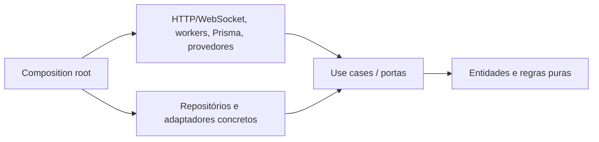

# Arquitetura adotada para o backend

**Base:** `docs/architecture.md` inteiro, com adoções e correções A-01–A-10 aprovadas em 23/10/2026. **Estado do repositório:** `apps/backend/src/shared/infra/http/app.ts` e `server.ts` são esqueleto Express; `apps/backend/prisma/schema.prisma` tem apenas generator/datasource. Nenhum modelo Prisma gerado anterior deve orientar o novo schema (Q-23).

## Regra de dependência e pastas



O desenho original mostra setas sólidas Domain → Services → Controllers → Frameworks apesar do texto correto dizer que camadas externas dependem das internas. Aqui as setas de dependência apontam para dentro (A-01). Controllers traduzem transporte e não implementam repositórios; repositórios concretos ficam na infraestrutura (A-02). Portas são definidas junto a aplicação/domínio conforme necessidade, sem importar framework.

```text
apps/backend/
  prisma/schema.prisma + migrations/
  src/domain/{entities,value-objects,rules,ports}/
  src/application/{use-cases,ports}/
  src/infrastructure/{persistence/prisma,notifications,files,security,video,signatures,jobs,observability}/
  src/shared/infra/http/{app.ts,server.ts,routes,controllers,middleware}/
  src/shared/infra/realtime/  (sinalização M3)
  src/shared/infra/workers/   (jobs M1+)
  src/shared/composition/    (injeção na borda)
```

Os caminhos dentro de `src/` além dos dois existentes são **proposta de organização**, não diretórios já presentes. O `docs/architecture.md` exemplifica `src/shared/app.ts` e `src/infrastructure/http/`; esta árvore mapeia ao monorepo real e mantém a regra Clean Architecture (A-03). Um use case por ação coesa, controllers sem negócio e interfaces pequenas preservam SOLID do documento de origem.

## Contratos e composição (A-04)

- `specs/shared/api-contracts.md` define REST/WebSocket, payload, erro e evento; `data-model.md` define entidades/constraints; `access-policy.md` define autorização; `parameters.md` define políticas configuráveis. Adapters implementam interfaces, sem alterar contratos por módulo.
- `app.ts` registra middleware de requestId, parsing limitado, CORS allowlist, autenticação/autorização, rotas, not-found e error handler. `server.ts` configura listener e desligamento gracioso. Composition root injeta repos/adaptadores de acordo com ambiente. O esqueleto atual usa CORS sem allowlist e rota `/`; BE-001/003 substituem essa configuração conforme spec.
- JWT access token curto em memória do cliente e refresh rotativo em cookie HttpOnly/Secure são proposta em `api-contracts.md`. BE-001/008 precisam definir domínio de implantação, SameSite, Origin/CSRF e proxy seguro quando necessário; nenhuma sessão clínica pode depender de controle só no front.

## Persistência e concorrência (A-05/A-08)

- Novo schema Prisma do zero, migrations versionadas, Postgres como fonte de verdade. Redis do Compose pode apoiar job/limite de taxa, mas não é fonte de verdade de consulta, consentimento ou auditoria.
- BE-020 especificará transação e constraint/exclusão no PostgreSQL para intervalos sobrepostos por profissional e sala. A leitura de disponibilidade é informativa; confirmação revalida e reserva atomicamente. A segunda transação recebe conflito; não há write parcial. Encaixe fora da grade obedece à mesma regra (Q-06).
- Rascunhos de evolução têm persistência periódica; finalização congela versão e adendo é append-only. AuditEvent também é append-only e a API não expõe update/delete. Retenção clínica e backups seguem RN-012/RNF-007.

## Portas/adaptadores externos (A-06/A-07)

| Porta | V1 / restrição | Lote |
| --- | --- | --- |
| `EmailSender`, `NotificationChannel` | Caixa/log local em desenvolvimento; portal; SMS/WhatsApp stubs. Categoria/consentimento checados antes do envio. | M0/M1 |
| `FileStorage`, `MalwareScanner` | Disco cifrado AES-256 por categoria, URL curta e autorização a cada download; scanner dev marca `skipped_dev` e é bloqueado em produção. | M0 |
| `SignatureProvider` | DevSignatureProvider gera hash/evidência, selo sem validade jurídica e bloqueio em produção; ICP-Brasil real é portão futuro. | M2 |
| `VideoSessionProvider` | WebRTC P2P com sinalização WebSocket própria, DTLS-SRTP; STUN/TURN próprio pendente P-10. Sem mídia processada no servidor. | M3 |
| `RecordingStorage` | Gravação MediaRecorder no cliente, enviada cifrada ao armazenamento local; expurgo/retention próprios, sem integrar prontuário. | M3 |
| `JobScheduler` | Entrega idempotente de lembretes, retry, expiração de oferta/acesso e expurgo; tecnologia concreta validada em cada spec. | M1/M3 |
| `Clock`, `IdGenerator`, `AuditWriter` | Portas injetáveis para regras temporais, IDs e testes determinísticos; auditoria em mesma unidade de trabalho quando cabível. | M0 |

DTLS-SRTP protege transporte, mas a interpretação V1 de RNF-014 **não prova criptografia fim a fim** do DRS (A-07/Q-12). RecordingStorage e chaves não podem reclassificar isso como conformidade plena. `04-open-questions.md` mantém P-04.

## Segurança, operação e evidências (A-09/A-10)

- M0 antecipa schema de identidade, RBAC, escrita de auditoria, admin seed, observabilidade e backup; M1 antecipa profissionais/salas antes de agendar. Consulta de auditoria completa vem M4, mas eventos já são escritos desde o primeiro login. O grafo de specs em `03-implementation-order.md` é acíclico.
- Logs estruturados com requestId, erros sem conteúdo sensível, métricas de latência/erro, health/readiness e alertas. Ambientes dev/homolog/prod separados; dados hospedados no Brasil para produção. Backup completo diário + incremental contínuo, RPO/RTO e teste de restauração semestral conforme RNF-007. Evidência de ambiente real exigida para RNF-006/024.
- Ensaios de carga/concorrência e mídia usam `shared/performance-scenario.md`; relatórios não confundem script disponível com meta verificada. Ao fim dos lotes, matriz indica cobertura total/parcial/pendente e portões jurídicos/técnicos.

## Implementação BE-006 — outbox local

Fila persistida no PostgreSQL (`Notification`), com chave única por evento/agregado/versão/destinatário. Dispatcher serializa por destinatário via advisory lock transacional; preferências são reavaliadas dentro do lock. BE-011 deve usar o mesmo lock ao revogar consentimento, e injetar sua leitura de consentimento na transação de entrega. Antes dessa dependência, envio para pacientes falha fechado; apenas mensagens de identidade de contas internas são permitidas pela política inicial. Nenhuma exceção legal de envio foi presumida.

Caixa de desenvolvimento usa arquivo privado por ID, publicação atômica e chave idempotente. Tokens de ação na outbox são cifrados com AES-256-GCM, chave derivada do segredo de ambiente e domínio próprio; a API do portal jamais devolve token/link de recuperação. Caixa dev não é endpoint estático nem log de aplicação. Produção exige provedor futuro, e recusa adaptador dev. Redis não é necessário para esse dispatcher M0.

## Bibliotecas de infraestrutura da API (direção do usuário, 29/10/2026)

O BarberHubAPI é referência para Zod, TSyringe, documentação OpenAPI/Scalar e testes HTTP. A decisão e os limites de adoção estão em `../_work/04-library-adoption.md`. Portas de aplicação permanecem interfaces; registros explícitos em um container por instância de app resolvem serviços sem depender de decorators no domínio. Schemas Zod validam entrada na borda e alimentam o OpenAPI 3.1 dos endpoints entregues. O contrato funcional continua em `shared/api-contracts.md`; qualquer divergência entre implementação, OpenAPI e spec precisa ser corrigida antes de avançar de milestone.
